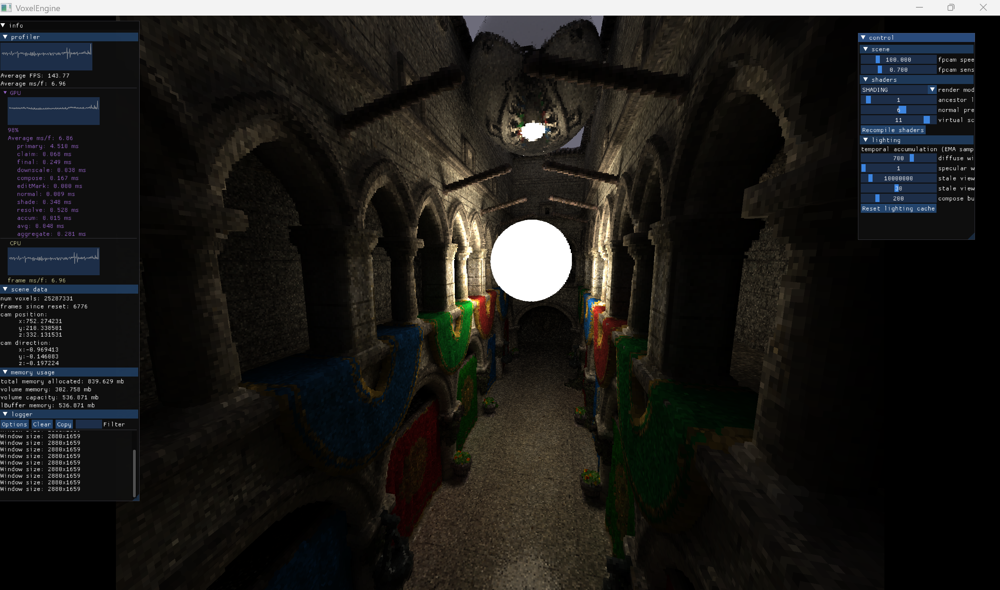
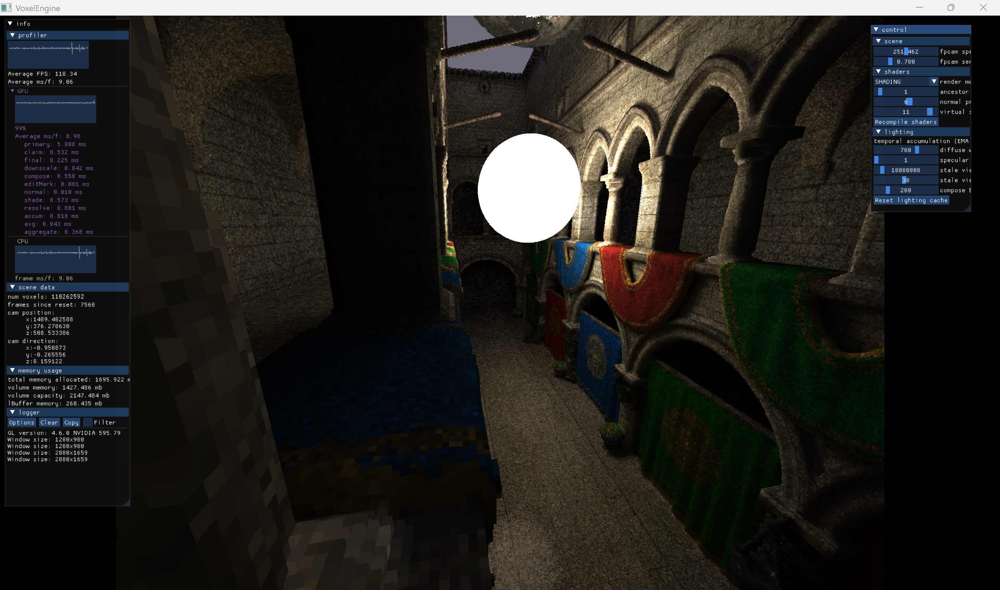
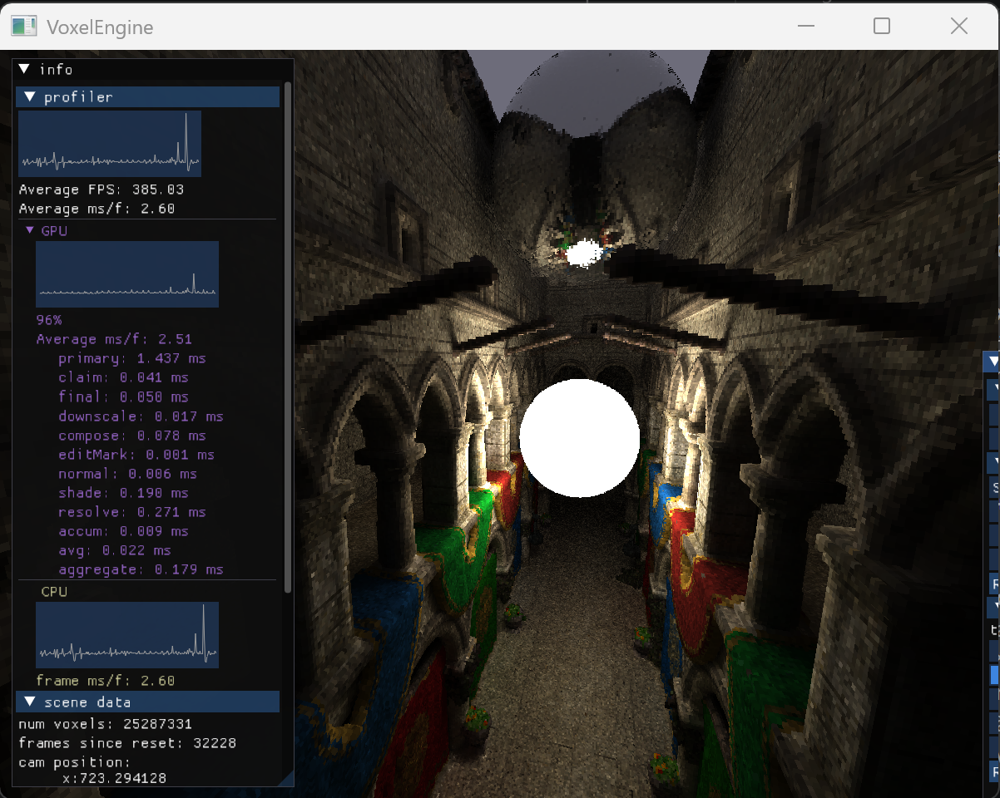
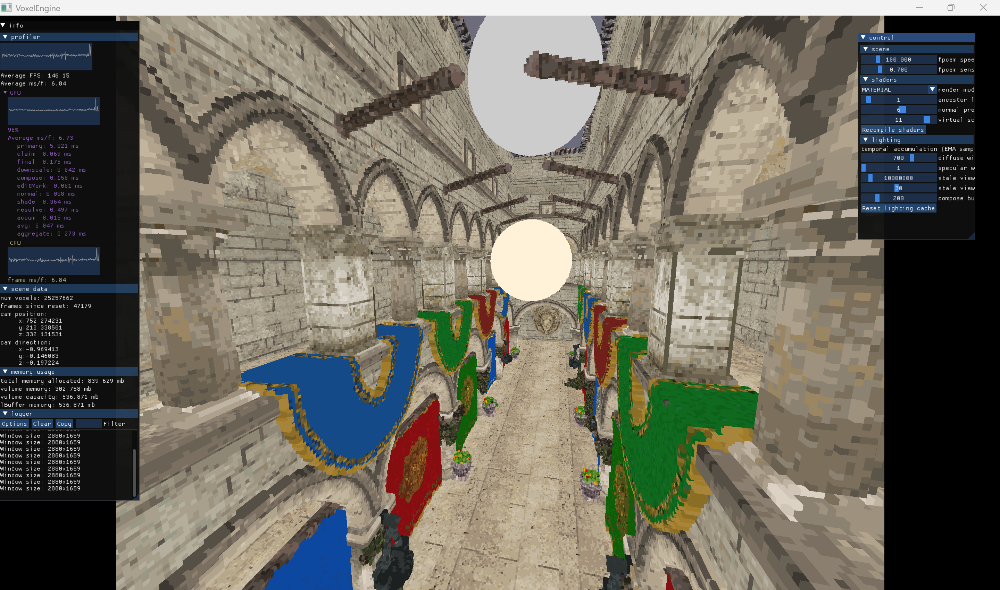
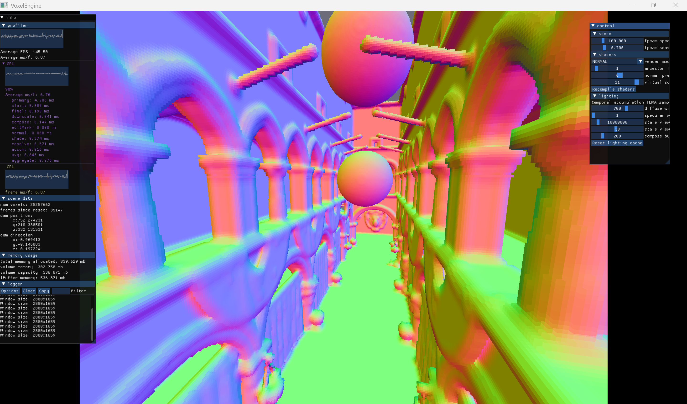
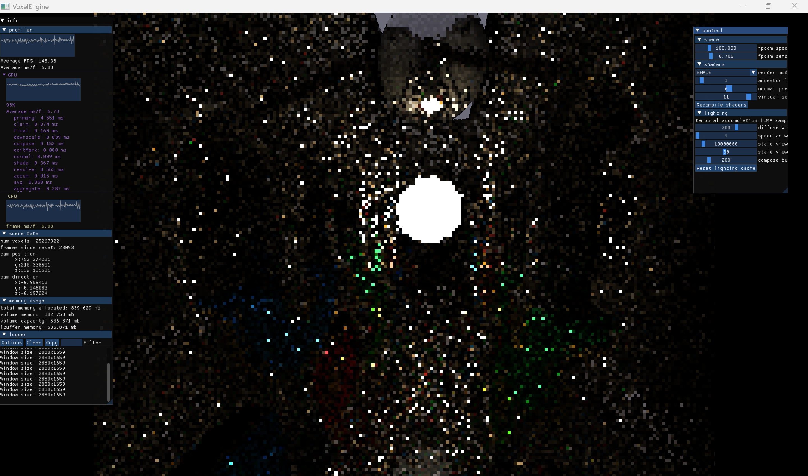
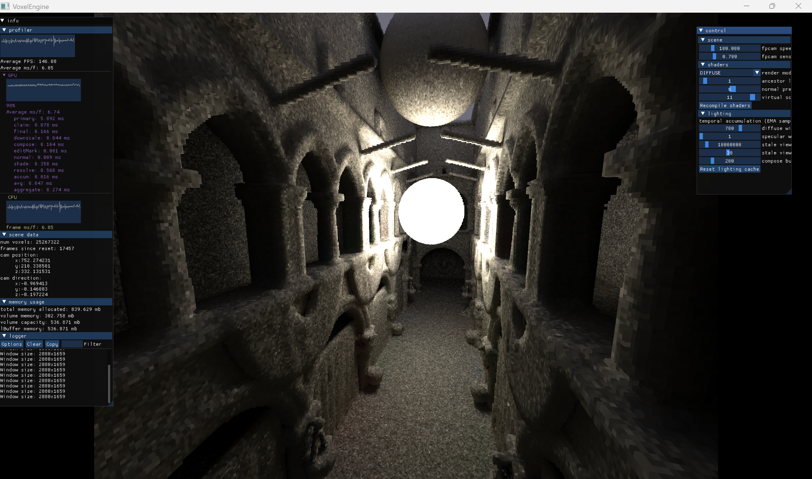
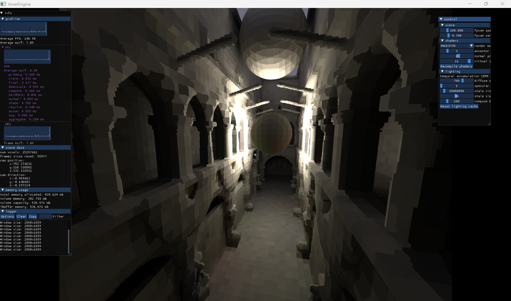
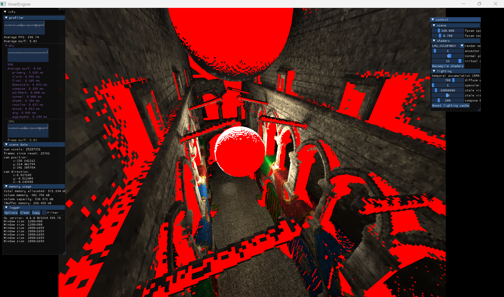

# VoxelEngine 3.0

A real-time **GPU path tracer for sparse voxel octrees**, written in C++ and OpenGL 4.6 compute
shaders. My third-generation voxel engine. It renders fully dynamic scenes of **over 100 million
voxels** with global illumination (soft shadows, color bleeding, glossy reflections) in real time on
a laptop GPU.

The core idea is a **hierarchical per-voxel irradiance cache**. Shading is decoupled from screen
resolution and accumulated in world space per voxel, so a single traced bounce plus cache feedback
converges to multi-bounce GI over frames. The octree's internal nodes aggregate their children's
lighting, so freshly seen geometry borrows from its ancestors instead of starting black and noisy.


*Sponza voxelized at 1001×420×616 (24.6 M voxels), 2880×1659, **144 FPS**. The only light is the
emissive sphere; everything else is bounce light.*

## Highlights

- **104 M voxels @ 110 FPS** at 2880×1659, and **24.6 M voxels @ 385 FPS** at 1200×900, on an RTX 4060
  Laptop GPU.
- **Hierarchical diffuse irradiance.** Each internal octree node keeps a 6-bin ambient cube built from
  all its resident children. A voxel with `n` of the `N₀` samples it needs borrows the rest from its
  ancestors, nearest first, so its blend weight is exactly `(N₀ − n)/N₀`. The cube's opposite bins
  keep the two faces of a thin wall apart, so no light leaks through it. The same hierarchy fills
  cache holes and stands in for uncached bounce hits.
- **Lock-free per-voxel cache.** A flat, open-addressed GPU hash table, claimed in a single dispatch
  by a CAS on a timestamp word (no spinning, no retries), LRU-evicted, with one 64 B cache line per
  slot. Each voxel's probe distance is baked into its octree node, so per-pixel reads are O(1).
- **Megakernel path tracer** on a downscaled virtual framebuffer: a cosine diffuse ray plus a GGX-VNDF
  specular ray, one bounce plus cache feedback, and a variance-adaptive per-voxel EMA. There are no
  shadow rays. Direct light is a bounce landing on an emissive voxel, so visibility is built in.
- **Sparse voxel octree.** 64-bit nodes in one SSBO, cache-line-aligned blocks, and a bitwise DDA that
  resumes from the common ancestor instead of the root.
- **Fully dynamic.** Live carving and insertion, versioned cache keys, and `.obj` voxelization with
  palettes extracted from textures.

## Performance

*NVIDIA GeForce RTX 4060 Laptop GPU, OpenGL 4.6, measured with the in-engine profiler.*

| Sponza grid | Voxels | Resolution | FPS | GPU frame | primary DDA | GI passes¹ |
|---|---|---|---|---|---|---|
| 1001 × 420 × 616 | 24,558,531 | 1200 × 900 | **385** | 2.51 ms | 1.44 ms | 0.80 ms |
| 1001 × 420 × 616 | 24,558,531 | 2880 × 1659 | **144** | 6.86 ms | 4.51 ms | 1.46 ms |
| 2001 × 838 × 1231 | 104,432,136 | 2880 × 1659 | **110** | 8.98 ms | 5.09 ms | 2.98 ms |

¹ Cache claim, shading, accumulation, hierarchical aggregation, compose and resolve, all together.

Per-pass GPU time (ms):

| Pass | What it does | 1200×900, 24.6 M | 2880×1659, 24.6 M | 2880×1659, 104 M |
|---|---|---|---|---|
| `primary` | full-res octree DDA → G-buffer | 1.437 | 4.510 | 5.088 |
| `downscale` | jittered virtual-res sample, dedup, ancestor discovery | 0.017 | 0.038 | 0.042 |
| `claim` | lock-free cache claim, voxels + ancestors | 0.041 | 0.068 | 0.532 |
| `editMark` + `normal` | normals for new or edited voxels | 0.007 | 0.009 | 0.011 |
| `shade` | megakernel path tracer, 1 bounce + cache feedback | 0.190 | 0.348 | 0.573 |
| `accum` + `avg` | per-voxel scatter + variance-adaptive EMA | 0.031 | 0.063 | 0.061 |
| `aggregate` | ancestor ambient cubes, every depth | 0.179 | 0.281 | 0.368 |
| `compose` | sample-budget borrowing from ancestors | 0.078 | 0.167 | 0.550 |
| `resolve` | full-res O(1) cache read + composite | 0.271 | 0.528 | 0.881 |
| `final` | present | 0.050 | 0.249 | 0.225 |

The frame is dominated by the primary-ray DDA. The entire GI pipeline costs about 1.5 ms at 2880×1659.
Hierarchical aggregation over every depth of the tree takes 0.28 ms.

## Images

### 104 M voxels: Sponza at 2001 × 838 × 1231, 110 FPS


### 1200 × 900: 24.6 M voxels at 385 FPS


### The same view through the pipeline

| Albedo | Normals (occupancy gradient) |
|---|---|
|  |  |

| Raw 1-sample path-traced signal | Converged diffuse irradiance |
|---|---|
|  |  |

| Ancestor cache, 3 levels up (8³-voxel cells) | Cache residency, frozen² |
|---|---|
|  |  |

² The cache was frozen at the original viewpoint and this shot was taken from a different position.
Red marks voxels the frozen view never cached.

The ancestor view shows what a fresh voxel borrows on its first frame. Each cell is coarse, but the
lighting is already correct: lit faces, shadowed undersides, and no leaks through walls.

## Tried and rejected

- **NEE with a light tree, RIS, MIS and ReSTIR DI.** Shadow rays aimed at one emissive voxel inside a
  cluster of emitters clip a neighbouring emitter first, so the sample is wasted and fireflies
  appear. Area sampling, MIS and ReSTIR reduced this but never cured it. NEE pays off for small,
  distant lights, and this engine's lights are emissive clusters, so the work went into making
  cosine-hemisphere sampling plus the cache cheap and well-converged instead.
- **ReSTIR GI.** Reservoir reuse of bounce samples largely overlaps with what the world-space cache
  already does: every bounce sample is reused across frames and pixels.
- **Hybrid world-space + screen-space filter** (and an earlier à-trous filter with screen-space hole
  filling). These borrowed from whatever was adjacent *on screen*, which was often a different
  surface at a different depth. Borrowing from a voxel's own octree ancestors replaced them.
- **Statistical compose.** Weighting ancestors by random-effects error never lets go: an ancestor's
  error falls with the samples of its whole cell, much faster than the voxel's own. A plain sample
  budget replaced it.
- **Scalar ancestor aggregates.** One value per cell leaks light through every thin wall. The 6-bin
  cube fixed it.
- **Inline second bounce with Russian roulette.** Noisy, slow, and recomputed every frame. The cache
  feedback provides further bounces for free.
- **Screen-footprint LOD over the full octree.** It was slower than full-resolution traversal.

## Build (Windows / MinGW)

Requires the MinGW C++ compiler and CMake 3.14–3.31.

```
git clone https://github.com/AnghelusAndrei/VoxelEngine3.0.git
cd VoxelEngine3.0
mkdir build && cd build
cmake -G "MinGW Makefiles" ..
cmake --build .
```
